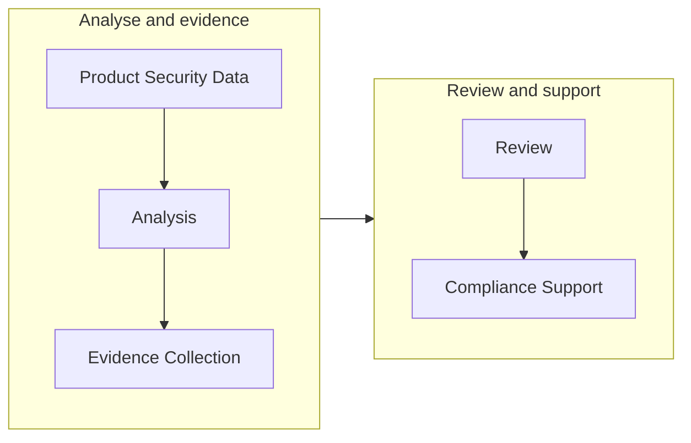

Aura helps teams organize cybersecurity information and evidence needed
to support compliance workflows.

Compliance activities in Aura are connected to product security
information, including:

-   Products and releases
-   Components
-   Vulnerabilities
-   Evidence
-   Security decisions

## Open Compliance in the upcoming navigation

The upcoming dashboard navigation may not yet be available in your deployment.
To open release-level Compliance, use **Products → choose a product release →
release overview → Compliance workspace**. Confirm the product and release before reviewing
evidence or recording a decision.

**Evidence** will be a tab in this workspace, not a standalone sidebar item.
Actual release Compliance workflows depend on your plan and permissions, with
Pro and Team access by default. Free users will see the existing **Evidence on
Pro** explanation with links to **Risks** and **Reporting**.

**Reporting** stays in primary navigation and is for confidential CRA case
evidence. It is distinct from release-level Compliance and Evidence; a release
review does not automatically disclose evidence to a Reporting case.

For read-only educational guidance, the upcoming workspace includes a
**Regulations reference** link. You will also be able to open it through
**Help → Reference → Regulations** in the Help footer. See
[Regulations](/compliance/regulations/) for how reference navigation differs from
reading an article inside Help.

## Compliance Workflow

A typical workflow is:

## Important Note

Aura supports compliance activities and evidence management. It does not
automatically certify a product or replace formal conformity
assessments.

## Related articles

- [Cyber Resilience Act (CRA) Overview](/compliance/cra-overview/)
- [Evidence Overview](/evidence/overview/)
