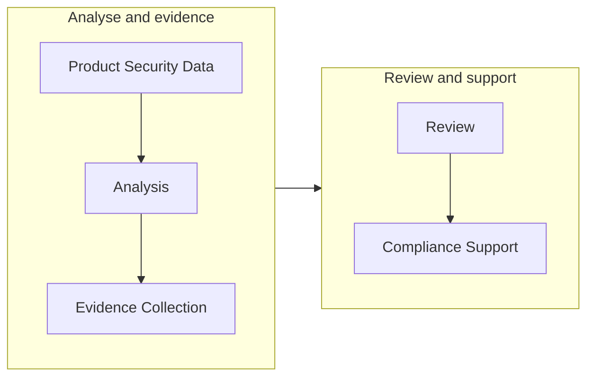

Aura helps teams organize cybersecurity information and evidence needed
to support compliance workflows.

Compliance activities in Aura are connected to product security
information, including:

-   Products and releases
-   Components
-   Vulnerabilities
-   Evidence
-   Security decisions

## Compliance Workflow

A typical workflow is:

## Important Note

Aura supports compliance activities and evidence management. It does not
automatically certify a product or replace formal conformity
assessments.

## Related articles

- [Cyber Resilience Act (CRA) Overview](/compliance/cra-overview)
- [Evidence Overview](/evidence/overview)
