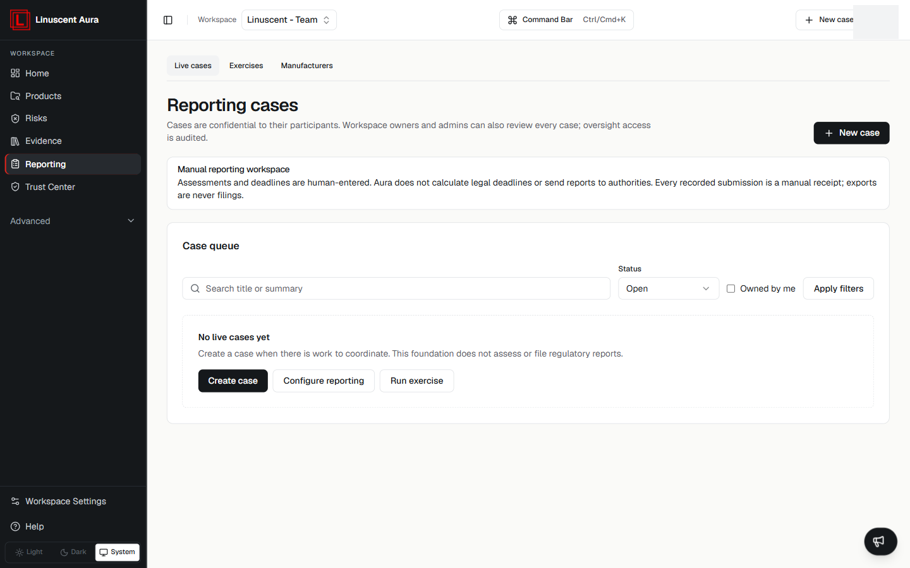
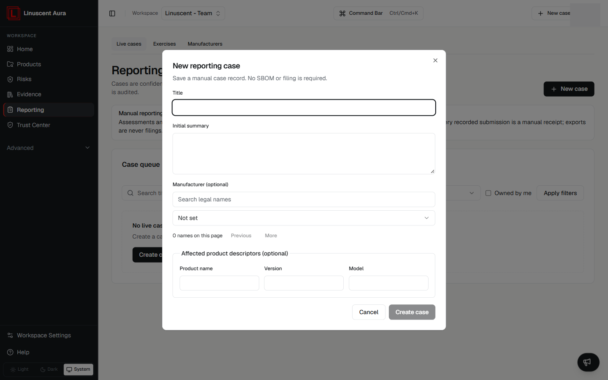

**Reporting cases** provide a manual workspace for coordinating regulatory
reporting work.

Cases are confidential to their participants. Workspace owners and admins can
review every case, and oversight access is audited.

Aura does not calculate legal deadlines or send reports to authorities. Every
recorded submission is a manual receipt; exports are never filings.

## Tabs

The Reporting page is organised into three tabs:

- **Live cases**
- **Exercises**
- **Manufacturers**

The **Live cases** tab is described below.

## Case queue

The case queue lists live cases with filters for **Search cases**, **Status**
(Open or Closed), and **Owned by me**. Select **Apply filters** to filter the
list.

When there are no cases, the queue shows **No live cases yet** with the actions
**Create case**, **Configure reporting**, and **Run exercise**.

## Create a case

Select **Create case** to open the **New reporting case** form. This saves a
manual case record; no SBOM or filing is required.

The form includes:

- **Title**
- **Initial summary**
- **Manufacturer** (optional) — search for a legal name to attach a manufacturer.
- **Affected product descriptors** (optional) — **Product name**, **Version**, and
  **Model**.

Select **Create case** to save the case, or **Cancel** to discard it.

## Related articles

- [Compliance Overview](/compliance/overview)
- [How Aura Supports CRA](/compliance/how-aura-supports-cra)
- [Trust Center](/compliance/trust-center)
- [Access and Permissions](/workspace-and-account/access-and-permissions)
