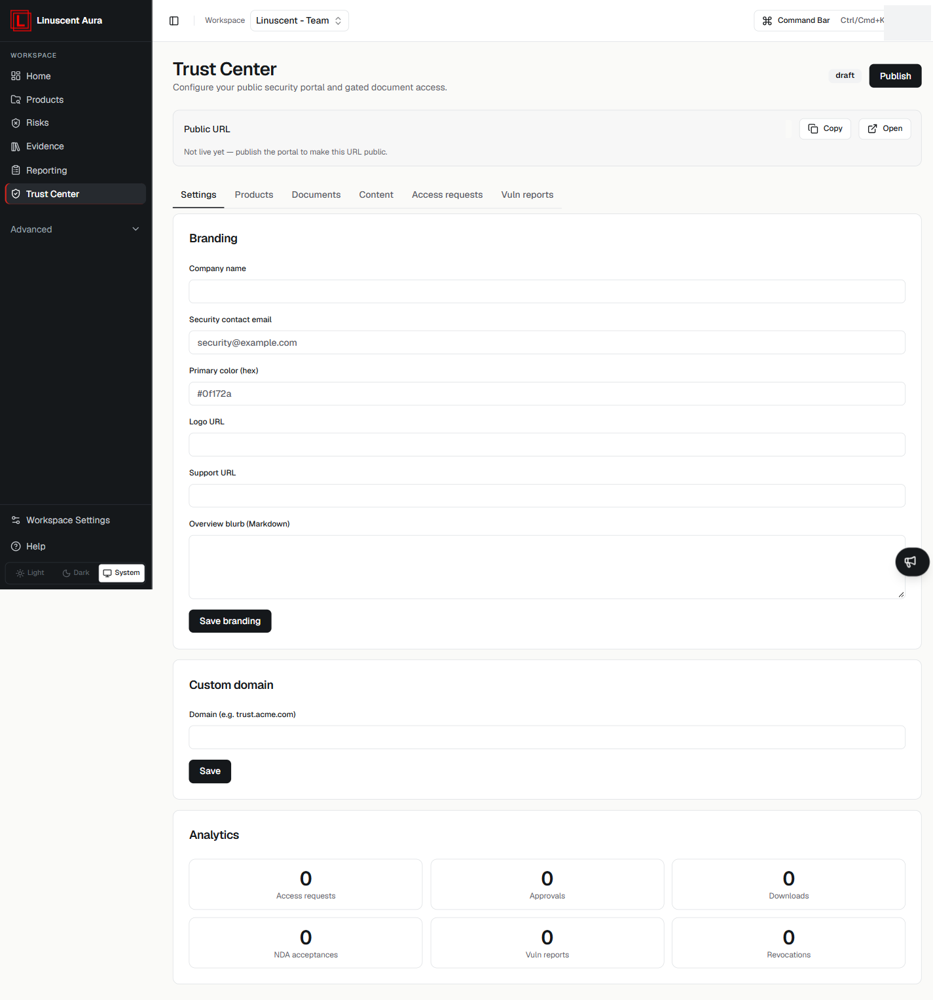

The **Trust Center** is Aura's public security portal and gated document access
for your workspace.

Select **Trust Center** in the left navigation to open it.

## Publish the portal

The portal starts as a draft. Select **Publish** to make it live. A public URL is
shown with **Copy** and **Open** actions; until you publish, the portal is not
live.

Publishing is a persistent workspace action. This article describes the
available settings; it does not publish the portal for you.

## Navigation tabs

The Trust Center is organised into tabs:

- **Settings** — branding, custom domain, and analytics.
- **Products**
- **Documents**
- **Content**
- **Access requests**
- **Vuln reports**

The **Settings** tab is described below. The remaining tabs are available but are
not covered in detail here.

## Branding

Under **Settings → Branding**, you can configure:

- **Company name**
- **Security contact email**
- **Primary color** (hex)
- **Logo URL**
- **Support URL**
- **Overview blurb** (Markdown)

Select **Save branding** to keep your changes.

## Custom domain

Under **Settings → Custom domain**, enter a **Domain** (for example
`trust.acme.com`) and select **Save**.

## Analytics

The **Analytics** section shows counts for:

- Access requests
- Approvals
- Downloads
- NDA acceptances
- Vuln reports
- Revocations

## Related articles

- [Reporting](/compliance/reporting)
- [Compliance Overview](/compliance/overview)
- [Workspace Settings](/workspace-and-account/workspace-settings)
- [Access and Permissions](/workspace-and-account/access-and-permissions)
