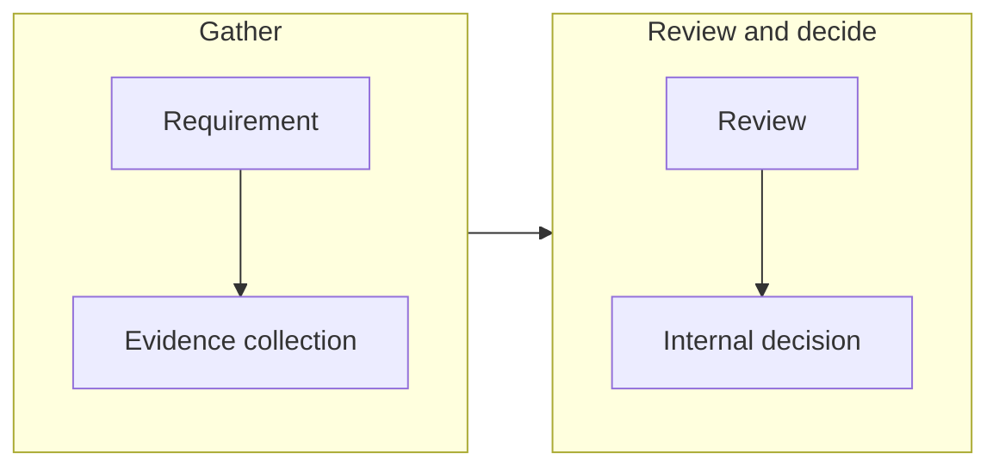

The evidence workflow helps teams organize information needed for
security reviews.

A typical workflow includes:

## Working With Evidence

Teams can use evidence workflows to:

-   Gather relevant security information
-   Review available supporting data
-   Record internal decisions

## Capture a saved vulnerability assessment

Evidence workflows require Pro or Team and the applicable workspace and product
permissions. Technical vulnerability assessments remain available on all plans.

1. On **Risks**, select the exact affected component, record its assessment and
   confirm that **Save** succeeded.
2. Choose **Review evidence** to open **Compliance → Evidence** with that finding
   selected. Check the product and release before continuing.
3. Choose **Preview saved assessment for Evidence**. Review the component,
   advisory, state, justification, response, details and suppression shown.
   Unsaved drafts are not included.
4. Select the confirmation that you reviewed the saved assessment, then choose
   **Capture assessment as Evidence**.

Aura rechecks the saved assessment during capture. If it has changed, obtain and
review a new preview. If capture is unconfirmed, inspect the Evidence list before
trying again: a record may already exist. Each explicit capture creates a separate
historical record.

## Review the historical snapshot

The Evidence record retains the assessment at capture time. Editing the current
assessment does not update it, and the captured snapshot has no edit or delete
action. Its **Inspect current finding** link opens the current assessment, which
may have changed or become unavailable.

The displayed name and time describe who captured the snapshot and when, not who
originally made the assessment or when that decision was made. Older records may
show that the capture-time name was not recorded. A content hash identifies the
captured assessment content; it is not a security certification.

## Support an internal release decision

1. Open **Compliance → Overview** for the same release.
2. Enter the internal decision's status, scope and basis.
3. Explicitly select the relevant records under **Supporting Evidence (optional)**.
   Use **Refresh available Evidence** if a newly captured record is missing.
4. Choose **Record internal decision** when your review is complete. This action
   requires internal-release-decision approval permission.

Decision history retains the selected Evidence citations and captured assessment
contents. Later changes to the current finding or Evidence metadata do not rewrite
those historical citations. Evidence is not selected automatically, and capturing
it does not itself approve a release, publish a VEX document or disclose it to a
Reporting case.

## Important Note

Evidence availability does not automatically represent compliance
certification or legal approval.

Teams remain responsible for evaluating requirements and making
appropriate decisions.

## Related articles

- [Evidence Overview](/evidence/overview)
- [Evidence Review](/evidence/evidence-review)
- [Compliance Overview](/compliance/overview)
