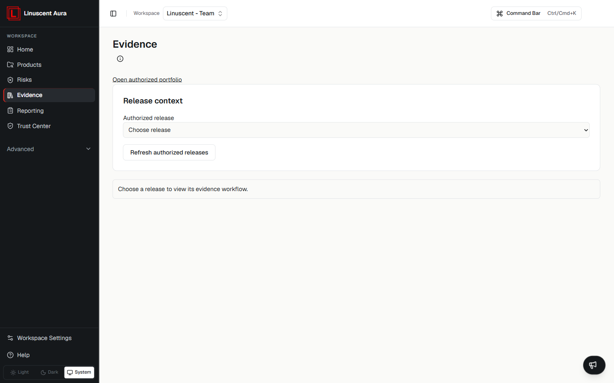

Aura Evidence provides a workspace for organizing cybersecurity evidence
and supporting compliance workflows.

Evidence helps teams collect, review, and manage information related to
security requirements.

## Open Evidence

Select **Evidence** in the left navigation, then choose an authorized release
with **Choose release**. You can also use **Open authorized portfolio** and
**Refresh authorized releases** to load the releases you can work with.

Until you select a release, Aura shows **Choose a release to view its evidence
workflow**.

## Evidence and Compliance

Evidence supports internal review processes and helps teams connect
security activities with applicable requirements.

Evidence should be treated as supporting information for internal
decisions and review workflows.

## Current Scope

The Evidence area may provide visibility into:

-   Evidence collection workflows
-   Requirement review
-   Internal documentation support

Compliance readiness indicators and evidence workflows depend on the
available Aura capabilities and configured data.

## On the Free plan

Evidence workflows are part of Pro and Team. On Free, the Evidence page explains
what you can already do and links to it:

- review and assess vulnerabilities on the Risks page;
- prepare reporting cases in **Reporting**.

It also lists what Pro adds, such as evidence collection, approvals, release
decisions, VEX exports and Trust Center. Workspace owners see an upgrade link;
other members are asked to contact the owner.

## Related articles

- [Evidence Workflow](/evidence/evidence-workflow)
- [Compliance Overview](/compliance/overview)
