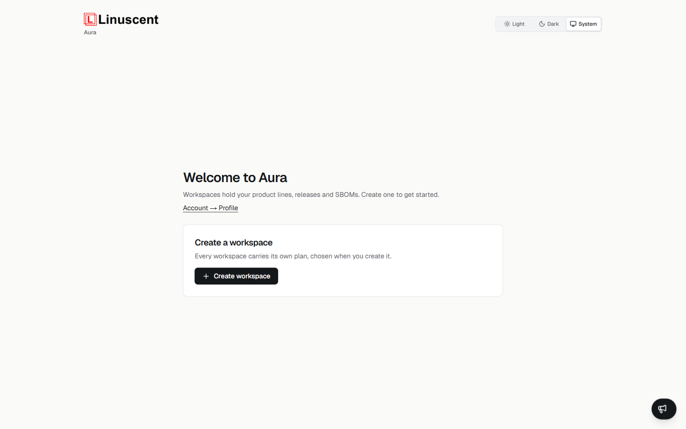
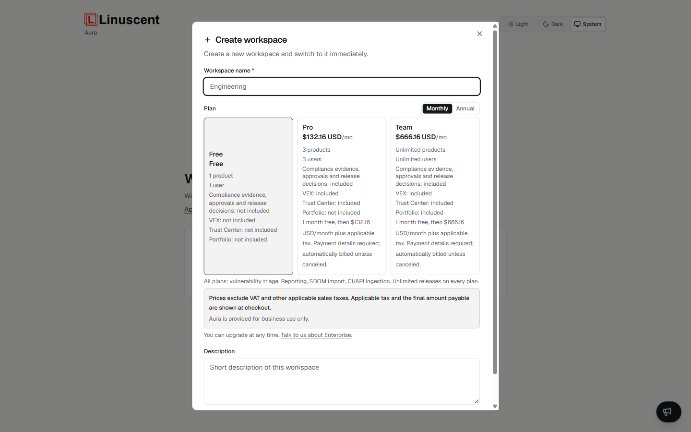
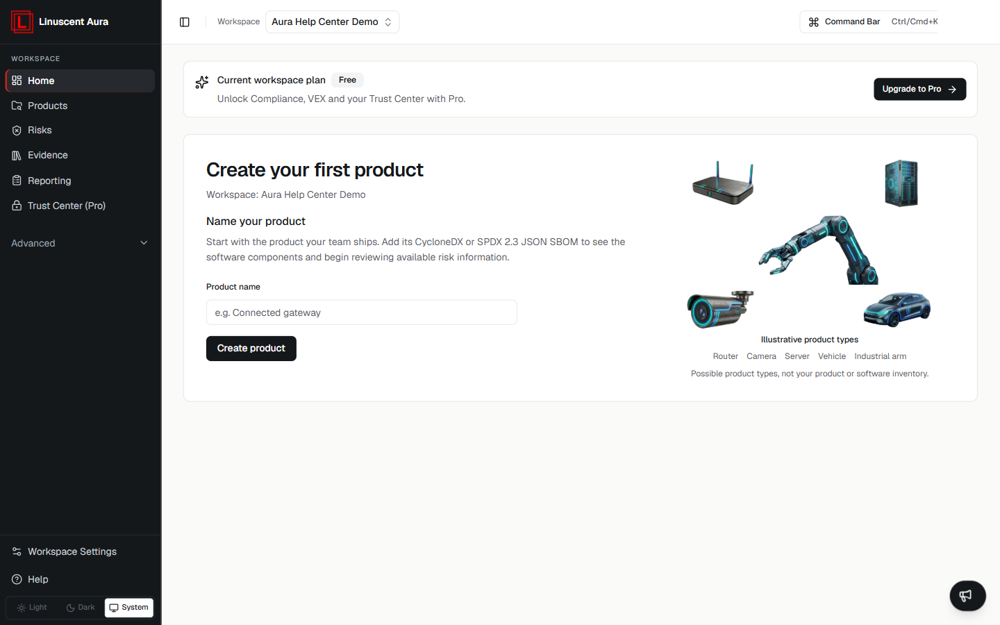
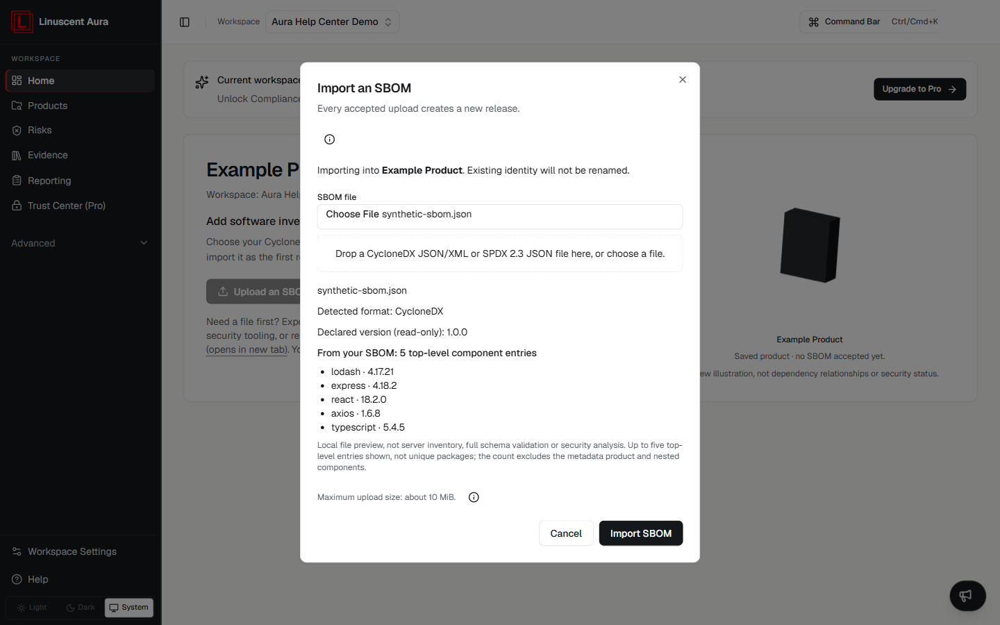
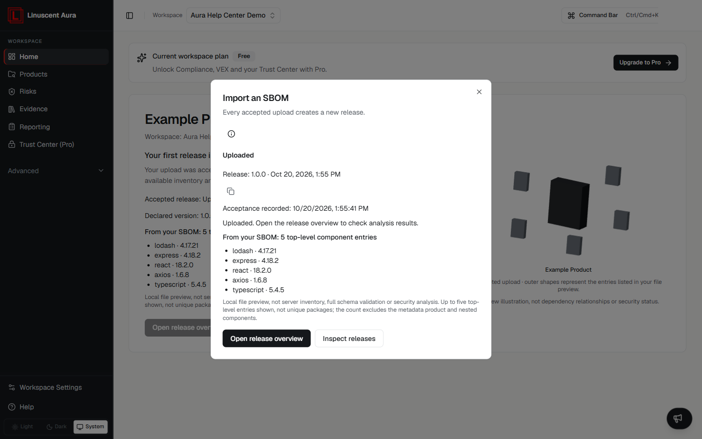

## Your first workflow

This guide walks you through the basic Aura workflow, from creating an account to reviewing the available results of your first SBOM upload.

At a high level:

```text
Create account
  ↓
Verify email
  ↓
Create workspace
  ↓
Choose workspace plan
  ↓
Create product
  ↓
Upload SBOM
  ↓
Aura creates a release
  ↓
Review results
```

## Before you begin

To complete this guide, you need:

- an Aura account;
- access to a verified email address;
- a CycloneDX JSON/XML or SPDX 2.3 JSON SBOM.

## 1. Create your account

On the Aura sign-up page:

1. Enter your name.
2. Enter your email address.
3. Create and confirm your password.
4. Accept the Terms & Conditions and acknowledge the Privacy Policy.
5. Complete the human verification check.
6. Select **Create account**.

Aura is provided for business use.

## 2. Verify your email

After creating your account, Aura asks you to verify your email address.

Open the verification message sent to your email address and complete the verification process.

If you did not receive the message, you can request another verification email from the verification page.

## 3. Create a workspace

After signing in for the first time, Aura displays the **Welcome to Aura** page.



A workspace contains your products, releases, SBOMs, and related security information.

Select **Create workspace**.

Enter:

- **Workspace name** — a name for the workspace;
- **Plan** — select one of the available workspace plans;
- **Description** — an optional description of the workspace.



Select **Create workspace**.

Aura creates the workspace and switches you to it automatically.

## 4. Create your first product

In deployments with the current onboarding, **Home** immediately shows the **Create your first product** form for an empty active workspace. There is no introductory screen or **Skip** action.

1. Enter a **Product name**.
2. Select **Create product**.

This creates a real product before you upload anything. The guided surface is only for an empty active workspace; a workspace that already has products, even without releases, uses the normal Home overview instead. Reloading after creating a product also returns to that overview, not another introduction.



You can also use **Products** → **New** → **New Product**, enter a name and optional description, and select **Create Product**. See [Create a product](/products-and-releases/create-product/).

A product is used to organise its releases, SBOMs, and related security data.

## 5. Upload your first SBOM

After guided product creation, select **Upload an SBOM**. If you do not have a file yet, export a CycloneDX JSON/XML or SPDX 2.3 JSON SBOM from your build or security tooling, or request one from your product supplier.

You can select **Open product without SBOM** to open that exact saved product and upload later. This keeps the product; it does not start an upload.

Aura accepts these SBOM formats:

- CycloneDX JSON;
- CycloneDX XML; or
- SPDX 2.3 JSON.

Choose or drag your SBOM file into the import dialog, review its local preview, then select **Import SBOM**. For CycloneDX, the guided preview counts top-level component entries, excluding the metadata product and nested components. For SPDX, it counts source package entries, not converted or ingested components. It shows up to five names and versions from those entries. Neither count is a unique-package count or server analysis. Missing values remain unavailable. For SPDX, an ambiguous or missing root package leaves the suggested name and version unknown; Aura does not guess a root, and an unknown version is okay.



The browser sends the original document text to Aura. CycloneDX is passed through unchanged; Aura converts SPDX server-side for analysis. Conversion can omit dependency relationships, which are not reconstructed, custom license definitions, and some file or snippet details. When relationships matter, generate native CycloneDX with the relationships included; completeness depends on the source SBOM. Where evidence capture is available, Aura retains the original SPDX document and its digest, not the converted document; this does not mean every upload is retained as downloadable evidence.

Outside guided setup, use **Import SBOM** from Home or Products, or the upload action on the saved product. See [Upload an SBOM](/sbom/upload-sbom/) for limits and recovery guidance.

## 6. Open the accepted release

Every accepted upload creates a distinct release, even for the same file or software version.

**Upload accepted** (HTTP **202 Accepted**) confirms acceptance and submission for analysis, not completed analysis or security clearance. The dialog does not automatically navigate away. Select **Open release overview** to open the exact saved release.



Closing the dialog does not undo the product or accepted release. During the current guided session, its acceptance receipt and file summary remain visible after closing. If the outcome is unclear, inspect Products and the product's releases before retrying; another accepted upload creates another release.

### Understanding the product illustration

Before creation, Home shows static Linuscent images of a router, camera, server, vehicle, and industrial arm as examples of possible products—not your product or its inventory. This view does not use WebGL. After creation, a 3D illustration represents your saved product. After an accepted upload, it adds shapes for up to five real entries from that file's preview—not every component. These are not dependency edges, a security graph, a live vulnerability scan, or an analysis-completion signal. The product name and full written preview values remain available alongside it.

After product creation, reduced-motion preferences or a WebGL failure use a static illustration instead. Product creation, upload, and release navigation work the same way.

## 7. Review your first results

The release overview shows available results; missing values do not mean zero findings or completed analysis. Use **Refresh results** to read current results without uploading again.

The summary can include metrics such as:

- Critical vulnerabilities;
- High vulnerabilities;
- Components.

From the release view, you can continue to areas such as:

### Inventory

- Components
- Dependency Graph

### Risk

- Risks

### Compliance

- Licenses
- Evidence

You can also review other release-related security information available in your workspace.

## What happens next?

Your SBOM is now associated with a release in Aura.

You can continue by reviewing:

1. the components identified in the SBOM;
2. vulnerability findings;
3. dependency relationships;
4. license information;
6. the security posture of the release.

You can upload another SBOM later to create another release and review how the product changes over time.

## Read Help without leaving your work

In deployments with current dashboard Help, select **Help** in the left-navigation footer to open a right-side modal with guidance for the current page. Pages without a dedicated article show the general guide with a fallback notice.

Follow article links and use **Back** within the panel. **Open in new tab** opens the article currently displayed; your browser settings decide whether it opens in a tab or window. Close the panel or press **Escape** to return to your unchanged work. On mobile, the navigation closes before Help opens.

Help is available in the normal workspace dashboard, not the onboarding screen before a workspace exists. It reads published documentation. If it cannot load, use **Retry**; the original dashboard page remains unchanged.

## Manual and automated SBOM ingestion

Manual SBOM upload is available from a product and is useful when getting started or testing Aura.

The **SBOM Ingestion** area is intended for automated ingestion workflows, including API and CI/CD integrations.

See:

- [SBOM ingestion](/integrations/sbom-ingestion/)
- [API ingestion](/integrations/api-ingestion/)
- [GitHub Actions](/integrations/github-actions/)

## Troubleshooting

If Aura rejects your SBOM or cannot process it, see:

- [Troubleshoot an SBOM](/sbom/troubleshoot-sbom/)
- [SBOM upload errors](/troubleshooting/sbom-upload-errors/)
- [SBOM validation errors](/troubleshooting/sbom-validation-errors/)

## Related articles

- [Key concepts](/getting-started/key-concepts/)
- [What is Aura?](/getting-started/what-is-aura/)
- [Products and releases](/products-and-releases/overview/)
