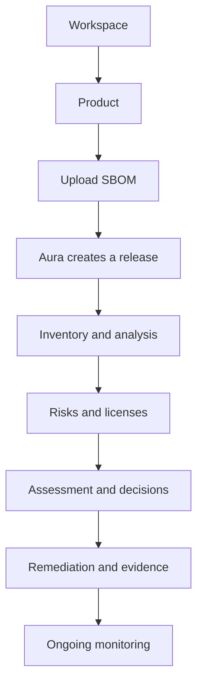

Aura connects software inventory, security findings, engineering decisions, and compliance evidence in one workflow.

At a high level, the process looks like this:

The exact capabilities available to you may depend on your Aura plan and workspace configuration.

## 1. Work inside a workspace

A workspace is the top-level area used to organise work in Aura.

A workspace can contain multiple products and has its own plan and configuration.

## 2. Create a product

A product is the main unit used to organise SBOM releases and related security data.

Create a product before uploading an SBOM.

## 3. Upload an SBOM

Open a product and upload a supported SBOM.

Manual upload is available from the product.

Aura accepts CycloneDX JSON/XML and SPDX 2.3 JSON. The browser sends the original document text to Aura; CycloneDX is passed through unchanged for analysis, while SPDX is converted server-side and some source details may be lost. When dependency relationships matter, generate native CycloneDX with those relationships included; completeness depends on the source SBOM. An accepted upload creates a release but does not mean analysis is complete. Use **Open release overview** from the acceptance confirmation or inspect the product's releases and refresh later; Aura does not automatically navigate or resubmit.

## 4. Aura creates a release

Each accepted SBOM upload creates a new release for the product.

This also applies when another SBOM is uploaded for the same software version.

Aura submits the release for analysis after acceptance. An HTTP 202 acceptance does not mean analysis is complete.

## 5. Review inventory and analysis

After processing completes, the release can be used to review information such as:

- components;
- dependency relationships;
- vulnerabilities;
- license information.

The exact views available may depend on your plan and workspace configuration.

## 6. Review and prioritise findings

Teams can review findings in the context of the affected product and release.

This may involve considering:

- severity;
- exploitability;
- how the component is used;
- product exposure;
- available fixes;
- internal security policies.

A finding does not automatically mean that the product is exploitable or non-compliant.

It indicates that additional review may be required.

## 7. Record decisions

Security decisions should be traceable.

For a vulnerability, a team may need to document whether the issue affects the product, why that conclusion was reached, and what action should be taken.

Where supported, Aura can maintain vulnerability decisions and VEX-related information alongside the release that was assessed.

Aura does not replace accountable engineering or security judgement.

## 8. Track remediation and evidence

When action is required, teams can track the work needed to address a finding.

This may include:

- upgrading a component;
- applying a security fix;
- replacing a dependency;
- accepting a documented risk;
- completing another approved remediation activity.

Aura can also retain evidence that supports security reviews, compliance activities, and audit preparation.

## 9. Monitor active releases

Security information changes after a release is created.

New vulnerabilities may be published, policies may change, and previously accepted findings may need to be reviewed again.

Aura can monitor active releases so teams can identify relevant changes over time.

Notification and monitoring capabilities may depend on your Aura plan.

## Manual and automated SBOM ingestion

Manual SBOM upload is available from a product and is useful when getting started or testing Aura.

The **SBOM Ingestion** area is intended for automated ingestion workflows, including API and CI/CD integrations.

## Aura and compliance

Aura helps teams structure and preserve product-security information that can support compliance activities.

For example, this information may contribute to work related to the EU Cyber Resilience Act (CRA).

Aura does not by itself determine whether a product meets all applicable regulatory requirements.

Your organisation remains responsible for regulatory interpretation, product decisions, and conformity activities.

## Next steps

Continue with:

- [Key concepts](/getting-started/key-concepts)
- [First steps in Aura](/getting-started/first-steps)
- [What is an SBOM?](/sbom/what-is-an-sbom)
- [Products and releases](/products-and-releases/overview)

## Related articles

- [What is Aura?](/getting-started/what-is-aura)
- [Key concepts](/getting-started/key-concepts)
- [Products and releases](/products-and-releases/overview)
