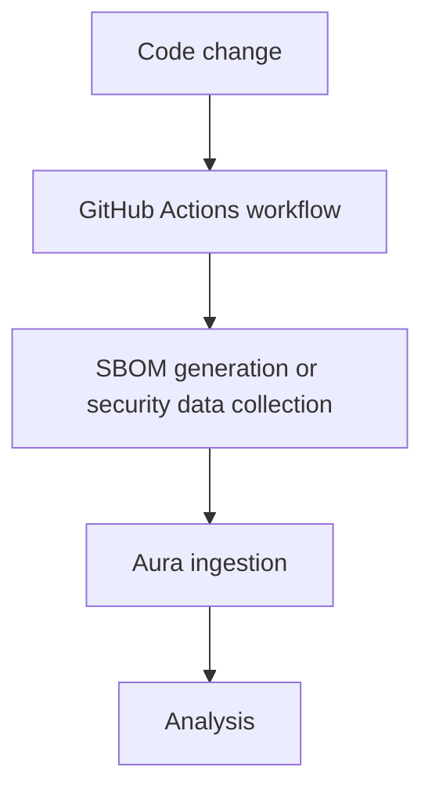

Aura can propose a GitHub Actions workflow that generates a CycloneDX SBOM with
sbomify and uploads it to an existing Aura product. Generation runs in your
GitHub Actions environment. Aura does not build your source or merge the pull
request. A sbomify account is not required.

## Check requirements

Automatic repository setup requires:

- an Aura workspace owner or admin account;
- an existing, active Aura product;
- administrator access to the GitHub.com repository;
- the Aura GitHub App configured by your Aura administrator and installed for
  that repository;
- a supported lockfile committed on the repository's default branch;
- GitHub Actions enabled and permission to use the generated action and container.

GitHub Enterprise is not supported by this connection flow. If GitHub shows
**Unavailable** in **SBOM Ingestion**, ask your Aura administrator to configure
the GitHub App. The manual workflow reference remains available below the
repository setup area.

## Understand who can access the key

:::caution[Trust every repository writer before continuing]
Aura installs a normal personal workspace API key as a **repository Actions
secret**. Every repository writer can access that key through a workflow they
create, including on an unprotected branch and before Aura's pull request is
merged.

The key has your workspace permissions, not only permission to upload SBOMs or
access the selected product. Only continue if every repository writer should
have that level of access to your Aura workspace.
:::

The protected-ref condition in Aura's generated job restricts that job. It does
**not** protect the repository secret from other workflows. This setup does not
use an environment secret or require environment-reviewer approval.

## Connect and review the workflow

1. Select the intended workspace in Aura and open **SBOM Ingestion**.
2. Under **Connect a repository**, select **Install GitHub App** and grant access
   to the intended repositories. Return to Aura and select **Connect GitHub**.
   Installation and account authorization are separate steps.
3. Under **Propose an ingestion workflow**, select GitHub, the repository and
   the Aura product.
4. Enter the repository-relative **Lockfile path**, such as `pnpm-lock.yaml`
   or `services/api/uv.lock`. Parent directories and wildcards are not accepted.
5. Choose the **Workspace API-key lifetime**: 30, 90 or 365 days.
6. Select **Preview file changes**. Review the proposed
   `.github/workflows/aura-sbom.yml` and the credential warning. Previewing does
   not create an API key or modify the repository.
7. If the trust model is acceptable, check the consent box and select
   **Create secret and open PR/MR**. Aura creates a new workspace API key,
   installs it under a unique secret name and opens the pull request.
8. Select **Review PR/MR**, inspect the change in GitHub, and merge it yourself
   when ready. Existing Aura workflow files are not overwritten.

Connections and setup records are private to your Aura account within the
selected workspace. Connecting GitHub does not change how you sign in to Aura.
If the repository changes or the preview expires, generate a fresh preview
before authorizing setup.

## Run the workflow

The generated workflow uses a pinned sbomify container and checkout action. It
runs on **protected tag pushes**, including tag names with slashes, or through
GitHub's **Run workflow** action on a protected ref. Configure the appropriate
branch protections or tag rulesets first. An unprotected ref skips the generated
job; it does not prevent other workflows from accessing the repository secret.

The workflow must be present on the default branch for GitHub's manual trigger
to be available. The workflow and selected lockfile must also exist at the ref
you run. Runner availability, repository Actions policies, private package
access and generator ecosystem requirements can affect execution.

An accepted upload creates a new Aura release. It does not mean analysis has
finished. Rerunning a successful upload creates another release, even when the
SBOM or version is unchanged. If an upload's result is uncertain, inspect the
product's releases before rerunning it.

## Manage failures, expiry and disconnects

- For **Setup needs attention**, read the message before retrying. Repository
  and status reads have retry controls; interrupted writes are not automatically
  repeated.
- For **Inspection required**, use **Inspect** and check the provider branch,
  pull request, secret and Aura key. A partially created pull request may refer
  to a key that Aura has already revoked. Do not assume it is ready to run.
- Failed setup replacement and automatic key renewal are not supported. Contact
  your Aura administrator to reconcile an interrupted setup. Do not repeatedly
  create new keys or rerun an uncertain upload.
- Keys expire after the selected lifetime and depend on the owner's continued
  workspace access. Review the setup's key ID and expiry, and use
  **Account → API Keys** to manage the key.
- **Disconnect** removes Aura's stored provider connection, but does not revoke
  the workspace key, delete the repository secret or workflow, close the pull
  request, or stop existing CI uploads. Revoke the specific Aura key to stop its
  upload access; remove the workflow and secret in GitHub separately if needed.
  You can also revoke the OAuth authorization in GitHub account settings.

## Related articles

- [GitLab CI Integration](/integrations/gitlab-ci/)
- [API Ingestion](/integrations/api-ingestion/)
- [SBOM Ingestion](/integrations/sbom-ingestion/)
- [Upload an SBOM](/sbom/upload-sbom/)
