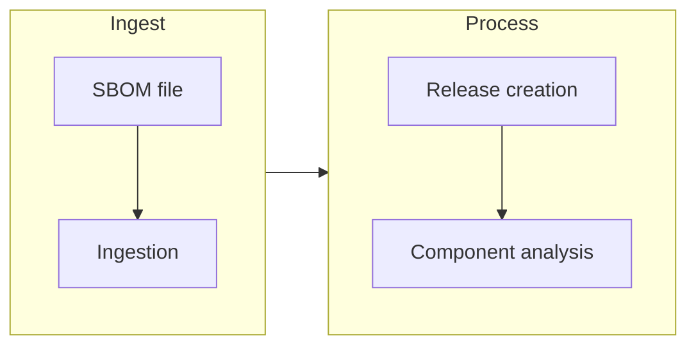

SBOM ingestion sends a Software Bill of Materials to an existing Aura product
and creates a release for analysis. You can upload a CycloneDX file manually,
send it through the API, or generate and upload it from your CI pipeline.

The **SBOM Ingestion** area provides Aura-native examples for ingesting SBOMs
through CI pipelines and direct API uploads.


## Workflow

The general workflow is:



## Connect a repository

**Connect a repository** generates an SBOM in your own CI and proposes the
configuration in a pull or merge request. Aura never builds your source or
merges the change.

Connections are private to your Aura account and workspace:

- **GitHub** requires repository administrator access.
- **GitLab.com** requires Maintainer access and the OAuth API scope to create
  files, merge requests, and protected CI variables.

In the current environment, both **GitHub** and **GitLab.com** show
**Unavailable**. These connections require an administrator to configure the
GitHub App (or GitLab.com OAuth) and repository encryption on the Aura server.
They are not active until that configuration is completed.

**Disconnect** only stops Aura from accessing the provider. To stop ingestion,
revoke the setup key in **Account → API Keys**, or remove its CI secret and
workflow.

## Quick API Reference

The API reference documents the direct upload endpoint:

- **Endpoint:** `POST /api/sbom/upload`
- **Authentication:** `Authorization: Bearer <AURA_API_TOKEN>`
- **Required body fields:**
  - `projectId` — the Aura project ID;
  - `sbomContent` — the CycloneDX JSON/XML or SPDX 2.3 JSON file contents as a
    string.

SPDX JSON is converted for analysis; some relationship and custom-license detail
may be absent.

## GitHub Actions

The **GitHub Actions** section provides a reference workflow for GitHub
pipelines that uploads an SBOM to Aura on push to `main`:

```yaml
name: Upload SBOM to Aura

on:
  workflow_dispatch:
  push:
    branches: [main]

jobs:
  upload-sbom:
    runs-on: ubuntu-latest
    env:
      AURA_API_TOKEN: ${{ secrets.AURA_API_TOKEN }}
      AURA_BASE_URL: https://<AURA_HOST>
      AURA_PROJECT_ID: <AURA_PROJECT_ID>
      SBOM_FILE_PATH: sbom.cdx.json
    steps:
      - name: Checkout
        uses: actions/checkout@v4

      - name: Build upload payload
        id: payload
        run: |
          sbomContent=$(jq -Rs . < "$SBOM_FILE_PATH")
          payload=$(jq -n --arg projectId "$AURA_PROJECT_ID" --argjson sbomContent "$sbomContent" '{ projectId: $projectId, sbomContent: $sbomContent }')
          echo "payload=$payload" >> "$GITHUB_OUTPUT"

      - name: Upload SBOM to Aura
        run: |
          curl --fail --show-error --silent -X POST "$AURA_BASE_URL/api/sbom/upload" -H "Authorization: Bearer $AURA_API_TOKEN" -H "Content-Type: application/json" --data "$PAYLOAD"
        env:
          PAYLOAD: ${{ steps.payload.outputs.payload }}
```

Replace `<AURA_HOST>`, `<AURA_PROJECT_ID>`, and the SBOM file path with your own
values, and store the API token as a GitHub secret.

## Supported Data

SBOM ingestion can provide information about:

-   Components
-   Versions
-   Dependencies
-   Software relationships

## Important Note

An accepted upload creates the basis for analysis; it does not mean processing
has finished. Each accepted upload creates a distinct release, even when the
content or declared version is unchanged. If you lose the upload response or a
CI job times out, inspect the product's releases before trying again.

## Set up repository generation

When your Aura administrator has configured a provider, workspace owners and
admins can connect GitHub.com or GitLab.com under **SBOM Ingestion**. Select an
existing product and lockfile, preview the proposed files, then explicitly
authorize creating a workspace API key, installing a CI secret and opening a
pull or merge request. Aura does not merge it automatically.

Generation runs in your CI environment using sbomify; a sbomify account is not
required. The generated job runs on protected tags or a manual run on a
protected ref, not on every push. A repository connection does not change the
release-per-upload behavior.

:::caution[Review the credential trust boundary]
The generated credential is a personal, full-role workspace API key, not an
upload-only key. Every GitHub repository writer can access its repository
secret through another workflow, even before Aura's pull request is merged.
GitLab setup uses a protected CI variable and requires trusting maintainers and
actors able to run protected-ref pipelines. Read the provider guide before
authorizing setup.
:::

Connections are private to your Aura account in the workspace. **Disconnect**
does not revoke the upload key or remove the provider workflow/secret. To stop
uploads, revoke the specific key through **Account → API Keys**. Keys also stop
working on expiry or loss of the owner's required workspace access.

Automatic setup allows one setup per repository in each workspace, including a setup
that needs inspection. It does not currently create multiple product mappings
for the same repository. Ask your administrator to reconcile an existing setup
instead of trying to create a duplicate.

Aura accepts CycloneDX JSON/XML and SPDX 2.3 JSON. SPDX is converted for analysis; dependency relationships are not reconstructed, and some source details may be absent. Prefer CycloneDX when a complete dependency graph is important. An accepted upload creates a release but does not mean analysis is complete.

## Related articles

- [GitHub Actions Integration](/integrations/github-actions/)
- [GitLab CI Integration](/integrations/gitlab-ci/)
- [API Ingestion](/integrations/api-ingestion/)
- [Upload an SBOM](/sbom/upload-sbom/)
