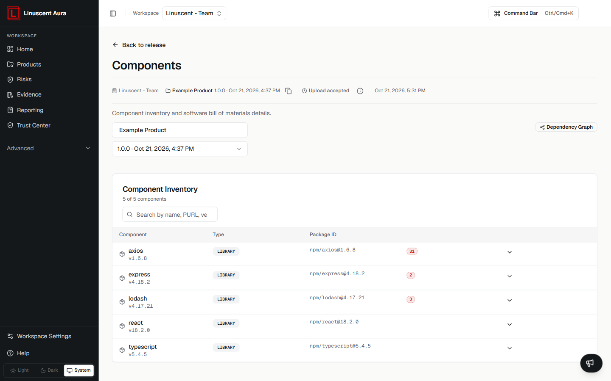

The Components view displays the software components identified from a
product release SBOM.

Each component represents a software dependency or package included in
the analyzed release.

## Component Inventory

The component list shows the components Aura identified for the release, with a
count such as **5 of 5 components**.

Each row shows:

- **Component** — the component name and version;
- **Type** — the component type (for example `LIBRARY`);
- **Package ID** — the package identifier (for example `npm/axios@1.6.8`);
- **Risk** — the number of findings for that component;
- **Details** — opens the component details.

## Component Details

Selecting a component provides additional information, including:

### Package Information

-   Name
-   Version
-   PURL
-   Type

### Provenance

Information about the origin and identification of the component.

### Security Information

Available security information may include:

-   Vulnerabilities

## Understanding Components

Component data reflects the uploaded SBOM contents. Results depend on
the information available in the source SBOM.

## Related articles

- [Inventory Overview](/inventory/overview)
- [Dependency Graph](/inventory/dependency-graph)
- [Understanding Findings](/risks/understanding-findings)
