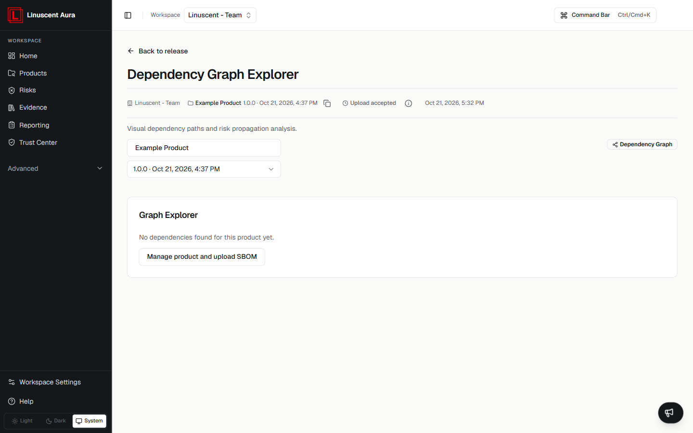

The Dependency Graph Explorer provides a visual view of relationships
between software components.

It helps teams understand dependency paths and how risks may propagate
through the software supply chain.

## Using the Dependency Graph

The graph can help answer questions such as:

-   Which components depend on each other?
-   How are dependencies connected?
-   Where can security risks propagate?

## Availability

Dependency information depends on the uploaded SBOM data.

If no dependency relationships are available, the Graph Explorer shows **No
dependencies found for this product yet** with a **Manage product and upload
SBOM** action.

## Related articles

- [Components](/inventory/components)
- [Inventory Overview](/inventory/overview)
- [Understanding Findings](/risks/understanding-findings)
