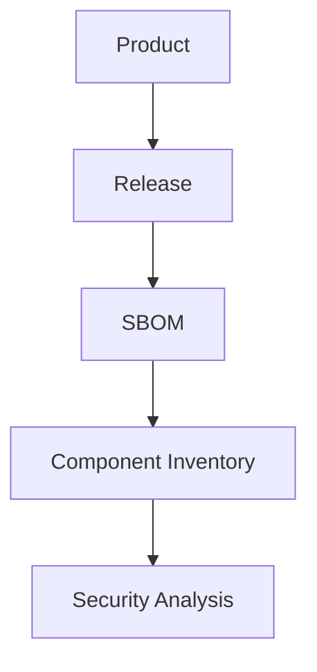

Aura inventory provides visibility into the software components that
make up a product release.

The inventory is created from uploaded SBOM data and helps teams
understand what software exists inside their products.

## Inventory Workflow

The typical flow is:

## Inventory Areas

The inventory section includes:

-   Components
-   Dependency Graph

Inventory information helps teams understand software composition,
dependencies, and related security context.

## Related articles

- [Components](/inventory/components)
- [Understanding Findings](/risks/understanding-findings)
