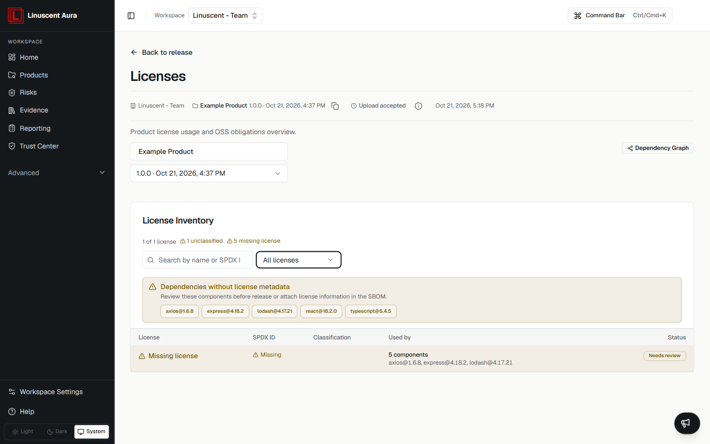

The **Licenses** view provides an overview of product license usage and
open-source software (OSS) obligations for a release.

## Open the Licenses view

Open the product and then the release you want to review, and select
**Licenses** in the release navigation.

The view shows the selected product and release, with a **Back to release** link
to return to the release overview.

## License Inventory

The **License Inventory** summarizes what Aura detected for the release:

- the total number of licenses;
- the number of unclassified licenses;
- the number of components with missing license information.

Use the **All licenses** filter to narrow the table to **OSI approved** or
**Unclassified** licenses.

The license table has these columns:

- **License**
- **SPDX ID**
- **Classification**
- **Used by**
- **Status**

A row such as **Missing license** lists the components that have no license
metadata and marks them as **Needs review**.

## Dependencies without license metadata

When components are missing license information, the **Dependencies without
license metadata** section lists them and asks you to review these components
before release, or attach license information in the SBOM.

## Important Note

License results depend on the information available from the uploaded SBOM and
connected analysis capabilities. Components without license metadata appear as
missing rather than being assigned a license.

## Related articles

- [Understanding Findings](/risks/understanding-findings)
- [Dependency Graph](/inventory/dependency-graph)
- [Upload an SBOM](/sbom/upload-sbom)
