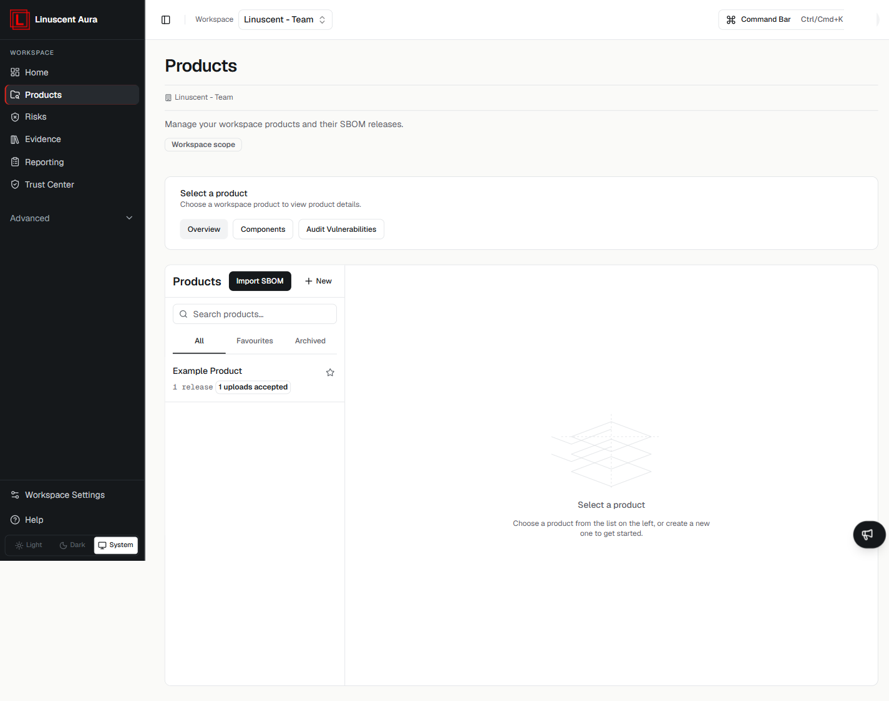

Aura organises software-security information around **products** and **releases**.

A product is the main container for SBOM uploads and the security information derived from them.

Each successful SBOM upload creates a new release inside the product.



## How products and releases fit together

The basic relationship is:

```text
Workspace
  ↓
Product
  ↓
Upload SBOM
  ↓
Release
  ↓
Inventory and analysis
```

A workspace can contain multiple products.

A product can contain multiple releases.

## Product

A **product** represents the software or product area you want to track in Aura.

Products help keep related:

- SBOM uploads;
- releases;
- software inventory;
- vulnerability findings;
- dependency information;
- license information;

grouped together.

## Release

A **release** is created when an SBOM is successfully uploaded to a product.

Each upload creates a new release, including when another SBOM is uploaded for the same software version.

This allows Aura to keep release-specific inventory and security information over time.

## Typical workflow

A common workflow is:

1. Create a product.
2. Open the product.
3. Upload a supported SBOM.
4. Wait for Aura to process the upload.
5. Review the release when its status becomes **Results ready**.
6. Review inventory and security information associated with the release.
7. Upload another SBOM when you want to create another release.

## Related articles

- [Create a product](/products-and-releases/create-product)
- [Upload an SBOM](/sbom/upload-sbom)
