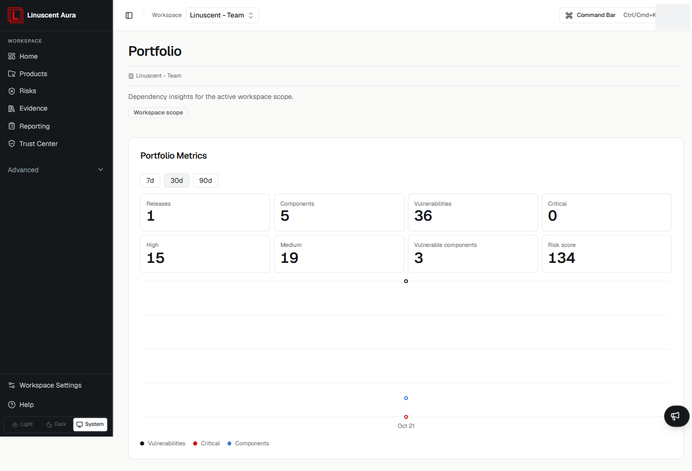

The **Portfolio** view provides dependency insights aggregated across the active
workspace scope.

Open it from **Advanced → Portfolio** in the left navigation.

## Portfolio Metrics

The **Portfolio Metrics** section shows metrics for the selected time range
(**7d**, **30d**, or **90d**):

- Releases
- Components
- Vulnerabilities
- Critical
- High
- Medium
- Vulnerable components
- Risk score

A trend chart below the metrics plots **Vulnerabilities**, **Critical**, and
**Components** over time.

## Scope and prerequisites

The portfolio reflects the **Workspace scope** — the active workspace. Metrics
are derived from the products and releases in that workspace, so they require at
least one analyzed release to appear.

## Related articles

- [Products and releases](/products-and-releases/overview)
- [Releases](/products-and-releases/releases)
- [Active release monitoring](/products-and-releases/active-release-monitoring)
- [Understanding Findings](/risks/understanding-findings)
