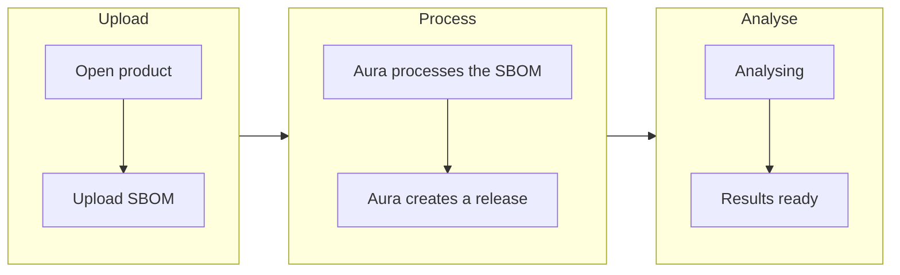

A release represents the result of a successful SBOM upload to an Aura product.

Aura creates releases automatically.

You do not need to create a release before uploading an SBOM.

## How a release is created

The workflow is:

Each successful SBOM upload creates a new release.

This also applies when another SBOM is uploaded for the same software version.

## What a release contains

A release connects the uploaded SBOM to the inventory and security information Aura derives from it.

Depending on the data available and your Aura configuration, a release can be used to review:

- components;
- dependency relationships;
- vulnerability findings;
- license information;
- security posture information.

## Release processing

After upload, Aura analyses the SBOM. The release overview and Risks show the
analysis status:

- **Analysing** — results are not available yet. Counts are shown as not yet
  available, never as zero. The page updates on its own; you do not need to
  refresh.
- **Results ready** — analysis has finished and the results are shown. A short
  notice appears when this happens while you are on the page.
- **Results may be incomplete** — analysis has not finished after about ten
  minutes. Select **Refresh** to check again.
- **Results unavailable** — Aura could not read the results.

**Results ready** means the analysis finished. It is not a security clearance,
and results can still change as new vulnerability information is published.

In the release list, the **Upload** column shows when the upload was accepted
(for example **Accepted · 25 Sep 2026**), not the analysis status.

If a release does not reach the expected state, see [Troubleshoot an SBOM](/sbom/troubleshoot-sbom).

## Release names

Aura labels each release by its declared version and upload time, for example
**1.0.0 · 25 Sep 2026, 12:50**, or **Unversioned · …** when the SBOM has no
version. Each release also has a longer technical name; use the copy button next
to the label if you need it, for example for support.

## Record optional release dates

In the product's release list, select **Edit dates** beside a release to record:

- **Declared release date** — the release date you provide for that release.
- **Support end date** — the date you provide for the end of its support.

Select **Save** to keep your changes, or **Cancel** to leave the saved dates
unchanged. Clear an input and save to remove that date. You can record either
date on its own; a missing date appears as **Not set**. When neither date is
recorded, editors see **Dates not set**.

Saved dates are shown in `YYYY-MM-DD` format without timezone changes. The date
picker may use your browser's local date format. These dates are separate from
the upload time and software version. Aura does not fill
them from the SBOM or require one date to be after the other. Recording a support
end date does not stop monitoring, change release status or approve a support
commitment.

Editing uses the same permissions as renaming a release. Archived releases show
recorded dates without edit controls. You do not need either date to upload an
SBOM or inspect its results.

## Multiple releases for the same version

Aura creates a new release for every successful SBOM upload, even when the software version is the same.

This allows the product to preserve the inventory and analysis associated with each upload separately.

## Why releases matter

Release-level records help teams answer questions such as:

- What components were present in this upload?
- What security findings were associated with it?
- Did the inventory change between uploads?
- Which release contained a particular component or issue?
- What evidence was available at that point in time?

## Related articles

- [Product overview](/products-and-releases/product-overview)
- [Active release monitoring](/products-and-releases/active-release-monitoring)
- [Products and releases](/products-and-releases/overview)
- [Upload an SBOM](/sbom/upload-sbom)
