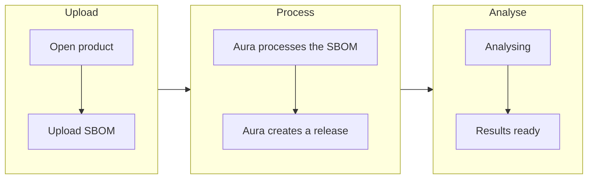

A release represents the result of a successful SBOM upload to an Aura product.

Aura creates releases automatically.

You do not need to create a release before uploading an SBOM.

## How a release is created

The workflow is:

Each successful SBOM upload creates a new release.

This also applies when another SBOM is uploaded for the same software version.

## What a release contains

A release connects the uploaded SBOM to the inventory and security information Aura derives from it.

Depending on the data available and your Aura configuration, a release can be used to review:

- components;
- dependency relationships;
- vulnerability findings;
- license information;
- security posture information.

## Release processing

After upload, Aura analyses the SBOM. The release overview and Risks show the
analysis status:

- **Analysing** — results are not available yet. Counts are shown as not yet
  available, never as zero. The page updates on its own; you do not need to
  refresh.
- **Results ready** — analysis has finished and the results are shown. A short
  notice appears when this happens while you are on the page.
- **Results may be incomplete** — analysis has not finished after about ten
  minutes. Select **Refresh** to check again.
- **Results unavailable** — Aura could not read the results.

**Results ready** means the analysis finished. It is not a security clearance,
and results can still change as new vulnerability information is published.

In the release list, the **Upload** column shows when the upload was accepted
(for example **Accepted · 25 Sep 2026**), not the analysis status.

If a release does not reach the expected state, see [Troubleshoot an SBOM](/sbom/troubleshoot-sbom).

## Navigate a release

Use **Overview**, **Components**, **Risks**, **Licenses**, or **Firmware analysis** to inspect
the same release. The release header stays in view when you switch tabs, and
each tab has its own link.

To review another release, select **Back to {product} releases**. Use **Search
releases** or choose a release from that product's list. **Search releases**
matches the release name or declared version.

## Compare two releases

Compare two releases of the same product to review inventory and finding changes.

1. Open the product's **Releases** list. You need at least two non-archived releases.
2. Select **Compare releases**. If you do not see it, clear the search and check that you are not viewing **Archived**.
3. Choose the **Candidate release** you want to evaluate and a different **Baseline release** to compare against. In either picker, search by name or declared version.
4. Select **Compare**.

Reopening the comparison link restores the chosen pair if you still have access to both releases.

- **Components**: Components appear as **Only in candidate**, **Only in baseline**, or **Version differs**. **Not matched** means Aura could not establish a reliable package identity or compare versions confidently.
- **Findings**: Findings appear as **Only in candidate**, **Only in baseline**, or **In both**. The comparison uses current analysis, including suppressed findings, rather than results from the time of upload. Baseline-only findings do not prove a fix. Comparison does not change or carry over assessment decisions.

Aura does not show rows for a section when it cannot verify full coverage; this can happen when a section is pending, incomplete, or unavailable. Select **Retry** in that section when analysis is ready or to try loading it again. Missing results do not mean there are no differences.

## Review release firmware

When firmware analysis is available, release managers can upload a binary from
the release's **Firmware analysis** tab. Uploading does not start
analysis. Select **Analyze firmware** once the release's vulnerability results
are complete and readable. A completed report with zero findings is valid.

The saved static advisory compares firmware observations with saved release
results, not a fresh vulnerability scan. See [Analyze release
firmware](/products-and-releases/firmware-analysis/) for permissions, coverage,
evidence, retry, and replacement behavior.

Where Assistant firmware actions are available, [ask about firmware in
chat](/products-and-releases/firmware-analysis/#ask-the-assistant-about-firmware)
using the exact Product and release. Follow **Open Firmware analysis** to
check progress or review the full saved advisory.

## Release names

Aura labels each release by its declared version and upload time, for example
**1.0.0 · 25 Sep 2026, 12:50**, or **Unversioned · …** when the SBOM has no
version. **Copy release ID** copies the release identifier, not its technical
name. When the technical name is displayed, use its separate copy control if
you need the name for support.

## Record optional release dates

In the product's release list, select **Edit dates** beside a release to record:

- **Declared release date** — the release date you provide for that release.
- **Support end date** — the date you provide for the end of its support.

Select **Save** to keep your changes, or **Cancel** to leave the saved dates
unchanged. Clear an input and save to remove that date. You can record either
date on its own; a missing date appears as **Not set**. When neither date is
recorded, editors see **Dates not set**.

Saved dates are shown in `YYYY-MM-DD` format without timezone changes. The date
picker may use your browser's local date format. These dates are separate from
the upload time and software version. Aura does not fill
them from the SBOM or require one date to be after the other. Recording a support
end date does not stop monitoring, change release status or approve a support
commitment.

Editing uses the same permissions as renaming a release. Archived releases show
recorded dates without edit controls. You do not need either date to upload an
SBOM or inspect its results.

## Multiple releases for the same version

Aura creates a new release for every successful SBOM upload, even when the software version is the same.

This allows the product to preserve the inventory and analysis associated with each upload separately.

## Why releases matter

Release-level records help teams answer questions such as:

- What components were present in this upload?
- What security findings were associated with it?
- Did the inventory change between uploads?
- Which release contained a particular component or issue?
- What evidence was available at that point in time?

## Related articles

- [Analyze release firmware](/products-and-releases/firmware-analysis/)
- [Product overview](/products-and-releases/product-overview)
- [Active release monitoring](/products-and-releases/active-release-monitoring)
- [Products and releases](/products-and-releases/overview)
- [Upload an SBOM](/sbom/upload-sbom)
