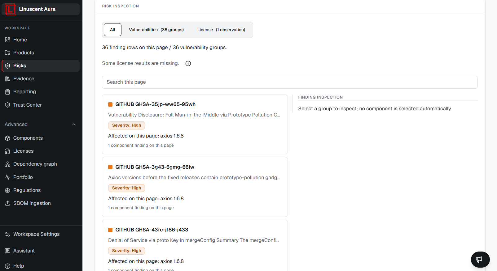

Aura Risks Center provides a view of security findings identified from
product releases.

Findings are generated from analyzed release data and may include
vulnerability and license-related observations.

## Finding Categories

Risk findings may include:

-   Vulnerabilities
-   License observations

## Finding Information

A finding may include:

-   Component affected
-   Vulnerability identifier
-   Severity
-   Available assessment information
-   Response or justification data when available

## Reading the Risks page

At the top of the Risks page, **Vulnerability groups by severity** shows a
coloured bar for the vulnerability groups currently loaded. It counts the loaded
page only, before search or view filters. It is not a release-wide total; the
release overview shows the release totals.

Use **All**, **Vulnerabilities** and **License** to change the view.
Each vulnerability group shows its identifier, a short summary, severity and
the affected component names and versions on the loaded page. One advisory can
have separate findings on multiple components; the group is not one shared
assessment for all of them.
Groups marked **Known exploited** are reported as exploited in the wild.

Select a group to inspect it. On wide screens the inspection panel stays in view
beside the list and scrolls on its own, so you do not need to scroll back up. On
smaller screens, selecting a group moves you to its details; select **Back to
list** to return to the group you selected. Long advisory text is shortened; select **Show
full advisory** to read all of it, and **Show less** to collapse it again.

Choose a component finding in the inspection panel to inspect its assessment.
Missing or ambiguous identity can leave a finding read-only. A missing Package
URL alone does not always prevent editing: Aura can use an exact finding
reference when available. See [VEX Decisions](/risks/vex-decisions/) for saving
technical assessments and reviewing suppressed findings.

To start with a component instead, expand it in **Components**. Its associated
vulnerabilities include suppressed findings, with links to inspect each exact
finding. See [Components](/inventory/components/).

## Important Note

Severity indicates the classified impact level of a finding. Severity
alone does not establish exploitability, reachability, or final risk
acceptance status.

## Related articles

- [Vulnerability Severity](/risks/vulnerability-severity)
- [Evidence Overview](/evidence/overview)
