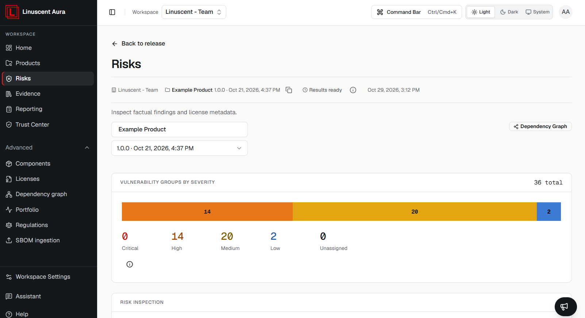

Aura displays vulnerability severity information to help teams
understand the potential impact of findings.

## Severity Levels

Findings may be classified by severity, including:

-   Critical
-   High
-   Medium
-   Low
-   Unassigned

## Severity colours

Aura uses the same colours for severity everywhere:

| Severity   | Colour |
| ---------- | ------ |
| Critical   | Red    |
| High       | Orange |
| Medium     | Amber  |
| Low        | Blue   |
| Unassigned | Grey   |

Grey is also used when no finding was observed or results are unavailable.
Colour is always shown with a label or count, so severity never depends on
colour alone.

## Interpreting Severity

Severity is one factor in risk evaluation. It should be considered
together with context such as component usage, exposure, and available
assessment information.

## Related articles

- [Understanding Findings](/risks/understanding-findings)
- [Prioritizing Findings](/risks/prioritizing-findings)
- [Evidence Overview](/evidence/overview)
