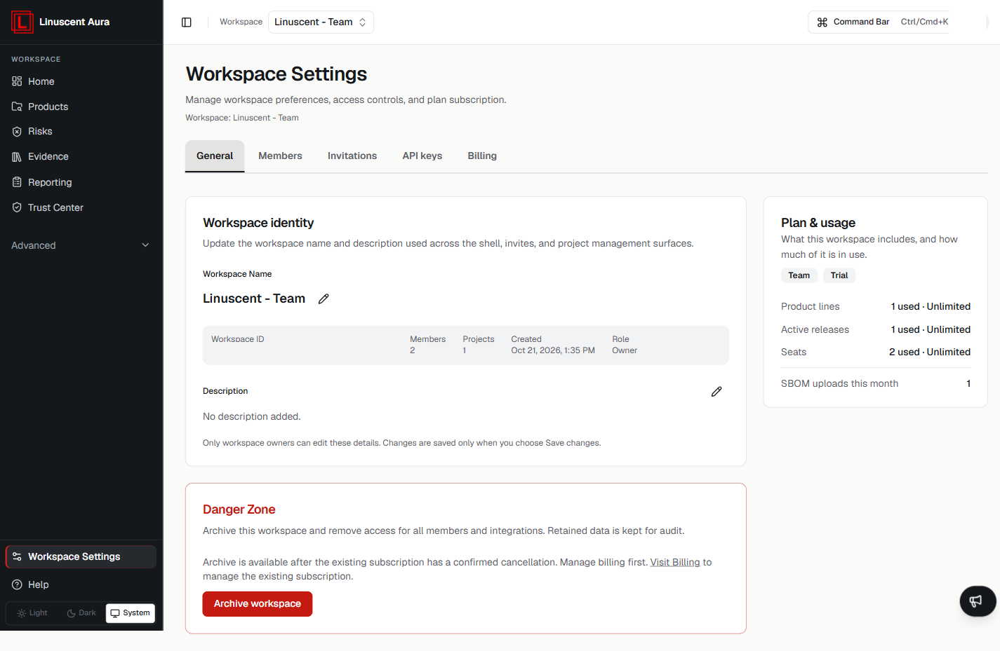

**Workspace Settings** is where you manage workspace preferences, access
controls, and plan subscription.

Select **Workspace Settings** in the left navigation to open it.

## Tabs

Workspace Settings is organised into tabs:

- **General** — workspace identity and plan usage.
- **Members** — workspace membership.
- **Invitations** — pending and sent invitations.
- **API keys** — personal API keys for API and MCP access.
- **Billing** — plan subscription management.

## General

The **General** tab shows:

- **Workspace identity** — the workspace name, workspace ID, and description,
  plus member and product counts and your role. Only workspace owners can edit
  these details; changes apply when you select **Save changes**.
- **Plan & usage** — the current plan and what is in use (product lines, active
  releases, seats, and SBOM uploads this month).
- **Danger Zone** — **Archive workspace**. Archiving removes access for all
  members and integrations; retained data is kept for audit. Archiving is only
  available after the subscription is cancelled.

## API keys

Create personal API keys under **API keys** to authenticate an API or MCP client
to the workspace. See [Connect an MCP client to Aura](/integrations/mcp-server/)
for setup and key safety.

## Related articles

- [Access and Permissions](/workspace-and-account/access-and-permissions)
- [Account](/workspace-and-account/account)
- [Workspace Overview](/workspace-and-account/workspace-overview)
- [First steps in Aura](/getting-started/first-steps)
